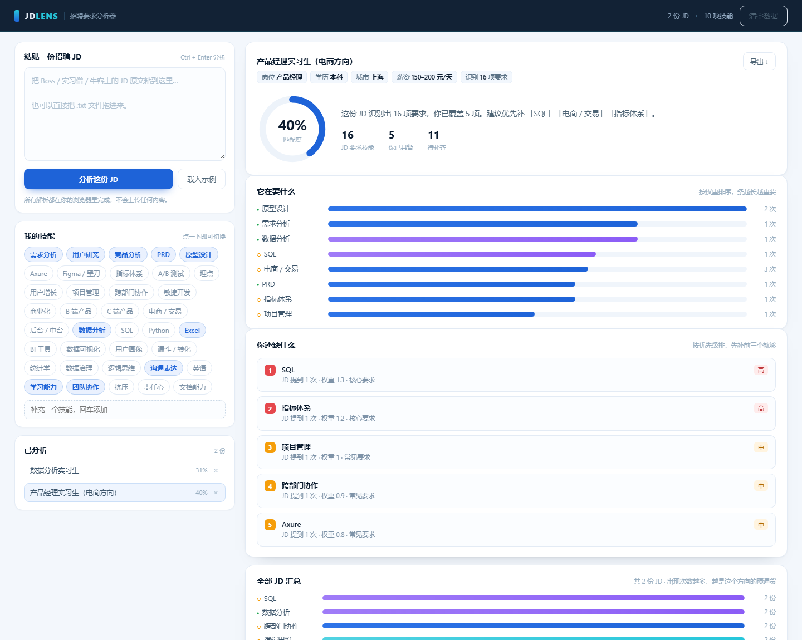

# JD Lens — Job description analyzer

> Paste a job posting, see in ten seconds what it actually asks for, what you are missing, and what to learn first.

**Live demo**: https://nanyang182.github.io/jd-lens/?demo=1



---

## Where it came from

While applying for internships I read job descriptions one by one, noting "this one needs SQL, that one needs metrics" in a text file. By the twentieth posting I realised I was collecting **scattered keywords instead of a capability map** — I could not tell which requirements were table stakes and which were one company's preference.

So I built the tool I wanted: it does not apply for me, it answers one question — **what does this posting really want, and where am I short.**

---

## What it does

| Feature | Detail |
|---|---|
| Paste or drag | Text paste, or drop a `.txt` file |
| Skill matching | 37-term dictionary across product / data / general skills, Chinese synonym matching |
| Fit score | Weighted by requirement strength, not a raw hit ratio |
| Gap ranking | Sorted by weight into high / medium / low, top 5 only |
| Multi-JD summary | After several postings, shows which skills keep appearing |
| Custom vocabulary | Add your own terms; history is re-scored automatically |
| Export | One-click Markdown for interview prep |
| Local storage | Everything stays in `localStorage`; nothing is uploaded |

---

## Trade-offs I made on purpose

**Why pure frontend, zero dependencies?**
No server to run, double-click to open, works offline during an interview, and your real resume/JDs never leave the browser. The cost is no cloud sync across devices.

**Why a dictionary instead of an LLM?**
Three reasons: every verdict is explainable (which term matched, how many times); zero cost and zero latency; I can edit the vocabulary myself. The cost is that it does not understand semantics — "data-driven growth" and "growth data" are not the same to it.

**Why weight the score?**
"Strong communication" and "knows SQL" are not the same requirement. A plain hit-ratio score can be gamed by listing soft skills, which makes the number meaningless.

---

## What it cannot do

1. **No semantics** — synonym matching misses unlisted phrasing, and "no SQL required" still matches SQL.
2. **No seniority judgement** — it sees the term, not whether it is required or preferred.
3. **Product-oriented vocabulary** — design/operations/engineering postings need `js/dict.js` edited.
4. **Fit score ≠ pass rate** — it measures coverage, not resume quality or interview performance.

---

## Layout

```
jd-lens/
├─ index.html      Structure
├─ styles.css      ~400 lines, no framework
├─ js/dict.js      Skill dictionary + sample JDs (the only "knowledge")
├─ js/parser.js    Parse, match, score
├─ js/charts.js    Ring + bar charts in plain DOM/CSS
└─ js/app.js       State, rendering, storage, export
```

Four scripts on a shared global namespace (no ES modules) so it runs from `file://` — module imports are blocked by CORS on the local file protocol.

---

## Related projects

- **Retail Insight** (data) → [nanyang182/retail-insight](https://github.com/nanyang182/retail-insight)
- **SplitLink** (backend) → [nanyang182/splitlink](https://github.com/nanyang182/splitlink)
