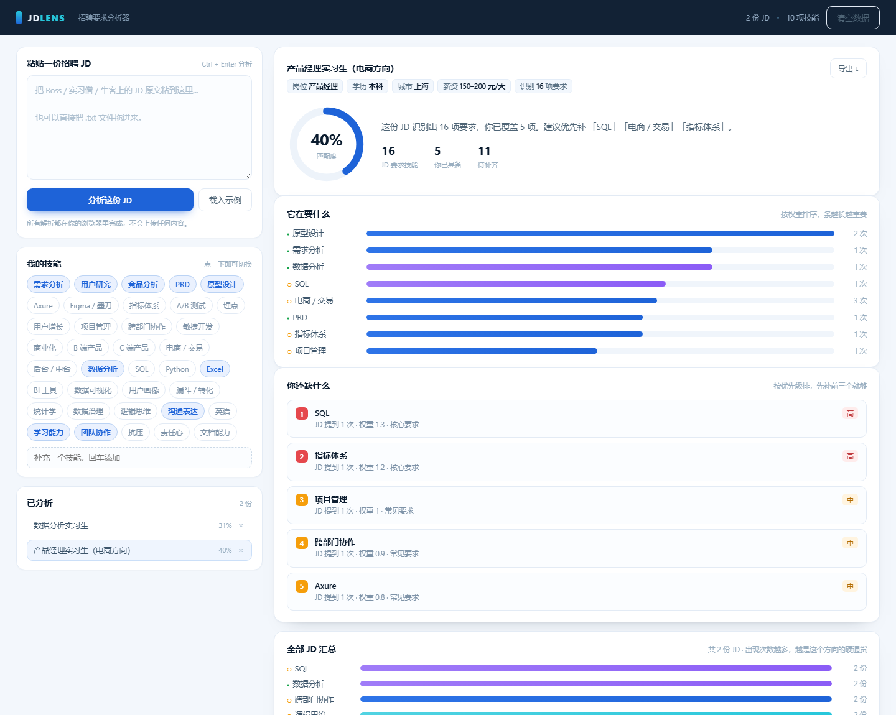

# JD Lens · 招聘要求分析器

> 粘一段招聘 JD，十秒看清：它在要什么、你还缺什么、先补哪个。



**在线试用**：`index.html?demo=1`（本地双击即可，不需要服务器）

---

## 一、它是怎么来的

找实习的时候，我一份一份地读 JD，用记事本记下"这份要 SQL、那份要指标体系"，读到第 20 份就发现：**我记的是零散关键词，不是能力结构**——看不出哪些要求是硬通货、哪些只是某家公司的偏好。

于是我做了这个工具：它不替我投简历，只回答一个问题——**这份 JD 真正在要什么，我差在哪。**

（顺带说明：这不是课程作业，是我自己用的工具，所以很多设计是从"我自己要天天用"出发的。）

---

## 二、它做什么

| 能力 | 说明 |
|---|---|
| 粘贴 / 拖拽 | 支持文本粘贴，也支持把 `.txt` 文件直接拖进来 |
| 技能识别 | 内置 37 项产品 / 数据 / 通用技能词库，按中文同义词匹配 |
| 匹配度 | 按"要求权重"加权算，不是简单数个数——提到 3 次的技能比提到 1 次的更重 |
| 缺口排序 | 按权重排优先级，分高 / 中 / 低三档，只保留前 5 个，避免"什么都缺"的焦虑 |
| 多份汇总 | 分析多份 JD 后，看哪些技能反复出现——那才是这个方向的硬通货 |
| 自定义词库 | 词典里没有的词可以自己加，加完自动重算历史记录 |
| 导出 | 一键导出 Markdown，可以贴进面试准备笔记 |
| 本地存储 | 全部存在 localStorage，刷新不丢，不上传任何内容 |

---

## 三、几个刻意的取舍

**为什么纯前端、零依赖？**
不需要服务器，双击就能用；面试现场没有网络也能演示；数据不出浏览器，敢把真实简历和 JD 贴进去。代价是没有云端同步，换设备就看不到历史。

**为什么用词典而不是接 AI？**
三个原因：① 可解释——每个判定都能指回"哪个词命中了几次"，面试官追问时不会支支吾吾；② 零成本、零延迟、断网可用；③ 词库我自己能改，加一个行业只需要改 `js/dict.js`。
代价是它不懂语义，"数据驱动增长"和"增长数据"在它眼里不一样，同义词没覆盖到就漏判。

**为什么匹配度按权重算，不按命中率算？**
因为 JD 里"沟通能力强"和"会 SQL"显然不是一个量级。纯按命中率，背下所有软技能就能刷到高分，这个分数就没意义了。

---

## 四、它不能做什么（面试会问，先说清楚）

1. **不懂语义**：靠同义词匹配，词库没覆盖的表达会漏；反过来说，也可能把"不要 SQL"识别成"要 SQL"。
2. **判断不了要求高低**：它只知道"提到了"，不知道是"必须"还是"优先"。
3. **词库是产品方向的**：换到设计、运营、开发岗需要改 `js/dict.js`，现在这版只对产品类 JD 准。
4. **匹配度不等于通过率**：它衡量的是"技能覆盖度"，不衡量简历质量、项目深度、面试表现。

---

## 五、文件结构

```
jd-lens/
├─ index.html        结构
├─ styles.css        样式（约 400 行，无框架）
├─ js/dict.js        技能词典 + 示例 JD（唯一的"知识"）
├─ js/parser.js      解析：抽元信息、匹配技能、算分
├─ js/charts.js      图形：匹配度环 + 条形图（DOM/CSS 实现）
└─ js/app.js         状态、渲染、交互、本地存储、导出
```

四个 JS 文件按职责拆开，全局命名空间挂载（`window.JD_DICT` 等），所以 `file://` 双击打开也能跑——ES Module 在本地文件协议下会被 CORS 拦掉，这是刻意绕开的。

---

## 六、可以拿去讲的产品点

- **发现问题的过程**：不是"老师让我做"，是"我读到第 20 份 JD 时发现自己在记关键词而不是结构"。
- **需求判断**：先做单份分析（高频、刚需），再做汇总（低频但决定方向），没有一上来堆功能。
- **取舍**：不接 AI、不做账号、不做云端——每一条都能说出理由和代价。
- **边界**：主动说清楚"不懂语义""判断不了要求高低"，比硬吹"AI 智能分析"更经得起追问。
---

## 相关项目

- **Retail Insight**（数据侧）→ [nanyang182/retail-insight](https://github.com/nanyang182/retail-insight)
  54 万条真实交易数据的分析看板：收入结构、客户分层、商品效率。
